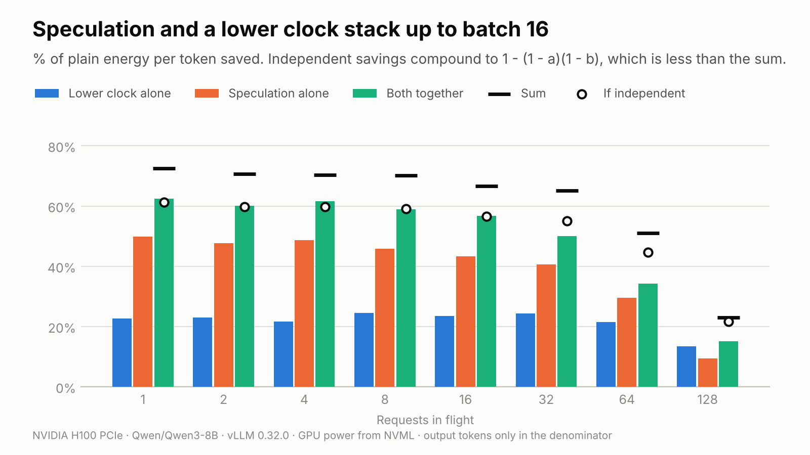

# spec-joules

Do speculative decoding and a locked GPU clock add up, or compete, for LLM decode energy?

On an H100 PCIe serving Qwen3-8B, they **stack up to 16 requests in flight**. With more, they compete.
Together they cut energy per token by 57–62% at small batches while decoding 1.6× faster.



## Why

- **A lower clock saves decode energy.** Decode mostly waits on memory, so the cores can run
  slower at lower voltage and barely lose speed.
- **Speculation uses idle compute.** A draft model guesses a few tokens and the big model checks
  them in one pass.
- **Both draw on the same slack.** Once speculation fills the idle compute, a lower clock has
  less to give back.

## Results

Savings in energy per output token, against plain decoding at the default clock:

| In flight | Plain | Clock alone | Speculation alone | Both | If independent | Speed, both |
| --- | --- | --- | --- | --- | --- | --- |
| 1 | 2.64 J | 23% | 50% | **62%** | 61% | 1.65× |
| 4 | 0.72 J | 22% | 49% | **62%** | 60% | 1.74× |
| 16 | 0.22 J | 23% | 43% | **57%** | 57% | 1.65× |
| 32 | 0.13 J | 24% | 41% | **50%** | 55% | 1.50× |
| 64 | 0.08 J | 21% | 30% | **34%** | 45% | 1.21× |
| 128 | 0.05 J | 13% | 9% | **15%** | 22% | 0.95× |

- **Independent savings compound** to `1 - (1 - a)(1 - b)`, less than the sum. Up to 16 in
  flight, both together reach that figure. From 32, they fall short.
- **The best clock barely moves.** Energy bottoms out around 915 MHz with or without the draft.
- **Speculation never costs energy here,** but its saving shrinks from 50% to 9% as the batch
  grows.
- **Acceptance was steady:** 43–50% of drafted tokens kept, at every batch size and clock.

Setup: one H100 PCIe (350 W, 1755 MHz max), vLLM 0.32.0, Qwen3-8B with
`RedHatAI/Qwen3-8B-speculator.eagle3` drafting 3 tokens. Medians of 2 repeats, 10 s each.
Charts and raw data: [`results/h100-pcie`](results/h100-pcie).

## How it measures

- **Clocks:** the default, then six locked steps from the max down to 40% of it.
- **Batch sizes:** 1 to 128 requests in flight, closed loop.
- **Best clock:** the fastest locked clock within 1% of the least energy per token.
- **Prompts:** HumanEval stubs and MT-Bench first turns, so the draft has real text to predict.
  Every arm and clock gets the same prompts at temperature 0.
- **Energy:** the GPU's own counter (NVML). Acceptance: vLLM's `/metrics` counters.

Chart titles are computed from the data.

## Run it

Needs root on a host that allows `nvidia-smi -lgc`, plus Docker with GPU support and uv.

```bash
OUT=out scripts/run.sh --duration 10 --repeats 2   # about an hour
uv run sj-plot out/plain.jsonl out/spec.jsonl       # --theme dark
```

The script sweeps a plain vLLM server, then one with the draft model. The clock is unlocked
when the sweep ends, fails or is interrupted.

Without a GPU (made-up numbers, charts watermarked SIMULATED):

```bash
uv run sj-sweep --simulate --arm plain --duration 2 --repeats 1 --out plain.jsonl
uv run sj-sweep --simulate --arm spec --duration 2 --repeats 1 --out spec.jsonl
uv run sj-plot plain.jsonl spec.jsonl
```

## Caveats

- GPU power only: no CPU, memory, networking or cooling.
- Energy per output token includes each prompt's prefill, the same in both arms.
- One card, model, draft and engine version. This card runs near its 350 W limit at large
  batches, so a 700 W SXM card may save more from the clock there.

## Prior art

- Ma et al., [*The Illusion of Power Capping in LLM Decode*](https://arxiv.org/abs/2605.11999)
  (2026): clock locking for decode on an H200.
- Fernandez et al., [ACL 2025](https://aclanthology.org/2025.acl-long.1563/), and Dutta et al.,
  [EACL 2026](https://arxiv.org/abs/2602.09113): the energy cost of speculative decoding.
- Yang et al., [*PELM*](https://arxiv.org/abs/2609.09662) (2026): speculation and DVFS together,
  on-device.

## Development

```bash
uv run ruff format && uv run ruff check && uv run mypy && uv run pytest
```

MIT license. Prompts: HumanEval (MIT), MT-Bench (Apache-2.0).
